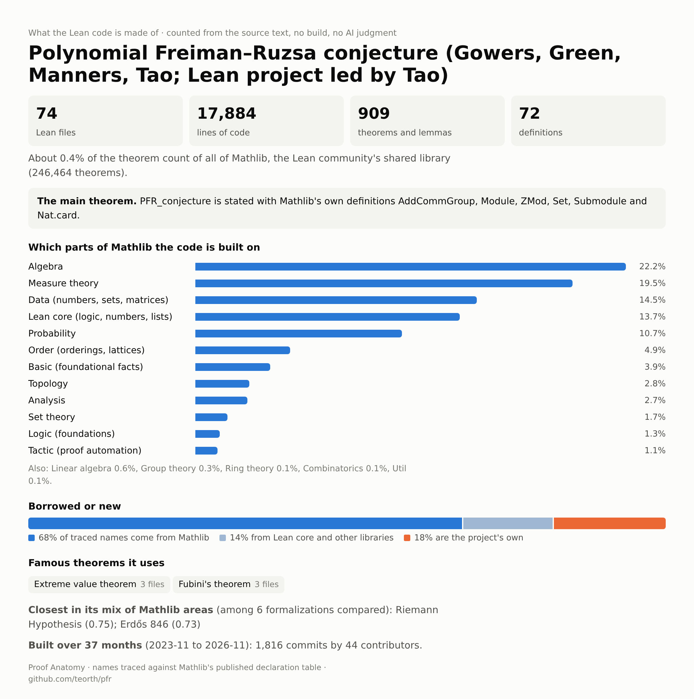

# Proof Anatomy

**What is a Lean proof made of?** Proof Anatomy reads the code of any Lean 4 formalization and draws a one-page card:
how big it is, which parts of Mathlib (the Lean community's shared library of mathematics) it is built on, how much it
builds by itself, which famous theorems it uses, and which other formalizations it most resembles.

Everything on the card is counted from the code. No AI model is involved and nothing is judged by hand, so anyone
who runs it on the same code gets the same card. The card does not say whether a proof is correct: Lean checks that
when the project is built.

**See the cards for seven formalizations, compared side by side:** https://eyal-weiss.github.io/proof-anatomy/
They include the polynomial Freiman–Ruzsa conjecture, the ongoing Fermat's Last Theorem project, Carleson's theorem,
sphere packing in dimension 8, the strong prime number theorem, an Erdős problem, and the proof of the Riemann Hypothesis announced in November 2026.

<p align="center"></p>

---

## Make a card, with no coding

You need an AI assistant that can run programs on a computer, such as **Claude Code**, **OpenAI Codex**,
**Gemini CLI** or **Cursor**. A chat window that cannot run programs will not work.

Copy this message into it, with the link to the Lean project you are curious about:

> Make a Proof Anatomy card for the Lean project at **https://github.com/OWNER/PROJECT**.
> The tool is at https://github.com/eyal-weiss/proof-anatomy; follow the instructions in its AGENTS.md.

The assistant will download the tool, find the project's main theorem (it will ask you if the project does not say),
and give you:

- **card.png**, a picture of the card that you can share;
- **card.html**, a web page with the card and more detail, which opens in any browser;
- **compare.html**, a page that compares the project with the seven formalizations above.

A small project takes under a minute. The 175,000-file Riemann Hypothesis archive takes about 3 minutes. The first
run also downloads about 70 MB of data from Mathlib's website.

## How to read a card

**The four numbers.** Lean files, lines of code, theorems and lemmas, and definitions. Comments and blank lines are
not counted.

**Size against Mathlib.** The same counts compared with all of Mathlib, which held about 246,000 theorems in
November 2026. The research projects in the reference set are about 1% of Mathlib or less; the Riemann
Hypothesis proof has more than three times as many theorems as Mathlib.

**The main theorem.** One sentence on how the main theorem is stated: with Mathlib's definitions only, or with the
project's own definitions (and what those are built on), or with plain notation such as numbers and powers.
A statement built only from Mathlib's definitions is easier to check against the original mathematics, because those
definitions are shared and widely reviewed.

**Which parts of Mathlib the code is built on.** Every file's lines are split among Mathlib's main sections
(algebra, measure theory, number theory and so on) according to the Mathlib results it uses. These sections are
the foundations a proof stands on. They are not the same as the research area of the proof: a number-theory proof
can be built mostly on algebra.

**Borrowed or new.** Of all the names the code uses that can be traced, the share that comes from Mathlib, the share
from Lean itself and the small libraries Mathlib relies on, and the share the project defines itself. A high share of
new names means the project had to build much of its own foundation.

**Famous theorems it uses.** Theorems from Mathlib's own lists of famous results (the "1000+ theorems" and
"100 theorems" lists) that the code calls by name, and in how many files.

**Closest formalizations.** Which projects in the comparison set have the most similar mix of Mathlib sections,
on a scale from 0 (nothing in common) to 1 (the same mix). It compares foundations, not the problems solved.

**Built over N months.** From the project's history: how long it was worked on, how many changes ("commits") were
made and by how many people. Shown only when the project has a history of at least 20 changes over 3 months.

The web page adds the statement traced name by name, the borrowed-or-new split by folder, a map of the
project's folders and how they import each other, and commits per month.

## What a card cannot tell you

- **Whether the proof is correct.** Only building the project with Lean checks that. Proof Anatomy never builds or
  runs the project's code.
- **Whether the proof is finished.** Projects in progress contain gaps (`sorry`); the card counts the code as it is.
- **How hard or important each part is.** A short file can hold the decisive idea and a huge folder routine
  groundwork. The card measures amounts, not importance.
- **Whether the main theorem says what its authors claim.** The card shows what the statement is built from; reading
  it against the mathematics is a job for people who know the field.

---

## For mathematicians, computer scientists and AI agents

### Run it yourself

Needs Python 3.9 or newer and git, plus numpy, scipy, PyYAML and Pillow. Chrome, Chromium or Edge is optional
(for card.png only).

```bash
git clone https://github.com/eyal-weiss/proof-anatomy
cd proof-anatomy
pip install -r requirements.txt

python3 anatomy.py https://github.com/teorth/pfr --main PFR/Main.lean --decl PFR_conjecture \
    --title "Polynomial Freiman–Ruzsa conjecture"
```

Output: `cards/pfr/card.png`, `cards/pfr/card.html`, `cards/pfr/card.json` and `cards/compare.html`.
`SOURCE` is a public `https://` link to a repository on GitHub, GitLab or Codeberg, or a folder on your computer. AI agents: follow [AGENTS.md](AGENTS.md).

| Option | Meaning |
|---|---|
| `--main FILE` | file holding the main theorem, relative to the project (without it, the card has no statement sentence) |
| `--decl NAME ...` | the main theorem's name(s) in that file (default: up to four theorems in the file) |
| `--title`, `--short` | the card's title, and a short name for comparisons |
| `--include DIR ...` | folders or files to count (default: the `lean_lib` roots in the lakefile; every `.lean` file if there are none) |
| `--src-dir DIR` | folder holding the sources (default: the lakefile's `srcDir`) |
| `--rev REV` | branch, tag or commit to analyse |
| `--out DIR` | output folder (default `cards`) |
| `--no-compare`, `--no-png`, `--no-history` | skip the comparison, the picture, or the commit history |
| `--keep-clone`, `--keep-records` | keep the clone or the per-file records (deleted by default) |
| `--procs N` | worker processes (default: half the cores, at most 5) |
| `--refresh-data` | download Mathlib's tables again |

### What it does

1. **Downloads Mathlib's tables once**: the declaration table behind the
   [Mathlib documentation](https://leanprover-community.github.io/mathlib4_docs/) (name, kind and module of every
   declaration) and Mathlib's `docs/1000.yaml` and `docs/100.yaml`. Cached in `~/.cache/proof-anatomy`
   (or `$PROOF_ANATOMY_DATA`).
2. **Fetches the project**: its commit history without file contents, then one commit's `.lean` and metadata files,
   written by the tool itself (see "Safety" below); everything is deleted at the end. Nothing in it is built or executed.
3. **Reads every `.lean` file as text** (`proof_anatomy/extract.py`): strips comments and literals, parses
   declarations with their namespaces, and resolves every identifier in Lean's lookup order (local variables, the
   current namespace and its parents, the name as written, then opened namespaces), line by line, against the
   declaration table and the project's own declarations.
4. **Computes the card** (`proof_anatomy/card.py`) and **compares it** with the reference set
   (`proof_anatomy/corpus.py`: cosine similarity of the mixes of Mathlib's second-level folders, average-linkage
   clustering).

### Safety

The tool treats every project as untrusted text and refuses anything unusual rather than trying to handle it. It
never builds or runs the project's code. It refuses:

- links other than plain `https://` addresses on github.com, gitlab.com or codeberg.org (no `ssh`, `git@`,
  `file://`, user names, tokens, ports, `?`, `#` or `%`); for other places, download the project and give its folder;
- a `--url` containing `@`, `?` or `#`;
- a symbolic link in the folder that is read, and an output folder inside a local project;
- a `--main`, `--decl`, `--include` or `--src-dir` that is not a plain relative path or Lean name, and lakefile
  folders or library names that are not (unless `--src-dir` or `--include` replaces them);
- projects with more than 500,000 Lean files or 4 GB of Lean code.

Git runs only on the tool's own fresh clone, never on a local folder (so local folders get no history chart), with
hooks, fsmonitor and signature checks off. A clone is made in steps: first the history and the list of files only (a
repository with more than 1,000,000 files, 500,000 Lean files or paths nested over 64 levels is refused here), then
that one commit's contents, kept packed inside git. The tool itself then picks the regular `.lean` files and the root
metadata files, adds up their exact sizes and the folders they need (over 4 GB on disk, counting whole blocks, or over
100,000 folders is refused) and writes their stored bytes directly, without a git checkout, so no attributes, filters,
line-ending conversions or links apply. Git's own data and the written files together may not pass 5 GB, and cloning
also stops after 30 minutes. The folder that is read may hold at most 2,000,000 files and folders, nested at most 64
levels deep (it is listed one entry at a time, with the limits checked as it goes); each step may write files of at
most 4 GB; reading history has every network transport disabled, a 5-minute limit and a 64 MB cap. Every step has a
deadline, lakefiles over 32 KB are refused, and on Linux each step runs under a hard memory limit (4 GB per process
for reading files and cloning, 8 GB for the card), so a project crafted to exhaust the machine stops the run instead.
Metadata files (`lean-toolchain`, `lake-manifest.json`, the lakefile) are read only as small ordinary files. Values
from the lakefile are passed on as values, never as options, and outputs are never written through symbolic links.
Files that are too large, too deeply nested or too slow to read are skipped with a note. Text from the project is
HTML-escaped on the card, and the cached Mathlib index is plain JSON.

The full method, every formula and every known limitation are in [METHOD.md](METHOD.md). `python3 tests/test_extract.py`,
`python3 tests/test_wrapper.py` and `python3 tests/test_security.py` run the regression tests (161 checks). Proof
Anatomy was written with Claude Code (Anthropic). Before release, OpenAI Codex reviewed the code in three rounds and
then for security; every confirmed finding was fixed and turned into a test, and the approximations that remain are
listed in METHOD.md.

### Accuracy and speed on the reference set

| Project | Files | Lines | Theorems | Own names | Qualified names traced | Time |
|---|---:|---:|---:|---:|---:|---:|
| [Riemann Hypothesis](https://eyal-weiss.github.io/proof-anatomy/rh/card.html) | 175,187 | 14,621,937 | 818,755 | 44% | 66.4% | 3.6 min |
| [PFR conjecture](https://eyal-weiss.github.io/proof-anatomy/pfr/card.html) | 74 | 17,884 | 909 | 18% | 84.2% | 2 s |
| [FLT project](https://eyal-weiss.github.io/proof-anatomy/flt/card.html) | 262 | 39,789 | 2,241 | 17% | 83.7% | 2 s |
| [Carleson](https://eyal-weiss.github.io/proof-anatomy/carleson/card.html) | 125 | 41,038 | 2,616 | 28% | 86.1% | 2 s |
| [Sphere packing (dim 8)](https://eyal-weiss.github.io/proof-anatomy/spherepacking/card.html) | 73 | 10,315 | 949 | 29% | 75.9% | 2 s |
| [Strong PNT](https://eyal-weiss.github.io/proof-anatomy/strongpnt/card.html) | 8 | 21,545 | 1,080 | 15% | 97.0% | 2 s |
| [Erdős 846](https://eyal-weiss.github.io/proof-anatomy/erdos846/card.html) | 1 | 811 | 47 | 64% | 68.0% | 1 s |

"Own names" is the project's share of all resolved name uses. "Qualified names traced" is the share of
`Namespace.name` uses that resolve to the declaration table (Mathlib, Lean core and the libraries Mathlib uses). Names
that do not resolve are mostly the project's own, fields of local variables, or Mathlib names renamed since the
project's pinned version (the table is today's Mathlib). Times are on a laptop with 5 processes, Mathlib's tables
already downloaded, cloning included.

### Outputs

`card.json` holds every number on the card: `numbers`, `mathlib` (Mathlib's counts), `statement` (sentences and the
name-by-name trace), `areas` and `areas_L2` (percent of code lines per Mathlib folder, first and second level),
`borrowed` (Mathlib, Lean core and other libraries, own), `famous`, `resemblance`, `history`, `folder_map`, `pins` (the project's pinned Mathlib and Lean
versions), `coverage`, `source` (URL and commit) and `mathlib_table` (when the table was downloaded).

### The reference set

The comparison set is in `reference/projects.json`, with each project's source, the folders counted, the main
theorem and why it was chosen; `reference/cards/` holds their cards. It will grow. To suggest a formalization, open
an issue with its link, the file and name of its main theorem, and where the project states it.
`scripts/rebuild_reference.py` rebuilds every reference card from source.

### Limitations

Proof Anatomy reads text; it does not elaborate Lean. It cannot see names that Lean generates (fields,
constructors, instances found by type class search), names used only inside tactics or notation, or local variables.
It traces names against today's Mathlib, while each project pins an older version. Numbers are therefore close
approximations of what a build-based tool would report, not exact dependency counts. For exact dependency traces,
build the project and query the Lean environment itself (for example with `#print axioms`). Details in
[METHOD.md](METHOD.md).

### License

MIT. Mathlib's data is downloaded from the Mathlib project (Apache 2.0) when you run the tool, not redistributed.
